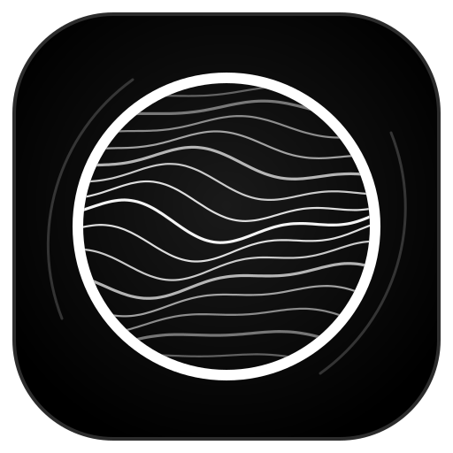

<div align="center">
  

<h1>Floorp Archwave</h1>

<p>
    A monochrome, privacy-hardened build of the <a href="https://github.com/Floorp-Projects/Floorp">Floorp</a> browser
    that runs Chrome Web Store extensions.
  </p>

<p>
    <a href="https://github.com/raigon-pawa/Floorp/actions/workflows/colocated_runner_test.yml"></a>
    <a href="https://github.com/raigon-pawa/Floorp/actions/workflows/docs_pipeline.yml"></a>
    <a href="LICENSE"></a>
    
  </p>

<p>
    <a href="#installation">Installation</a> ·
    <a href="#features">Features</a> ·
    <a href="#privacy-defaults">Privacy defaults</a> ·
    <a href="#development">Development</a> ·
    <a href="#credits-and-licenses">Credits</a>
  </p>
</div>

> [!NOTE]
> This is an **unofficial, personal fork** of Floorp. It is not affiliated with
> or endorsed by Ablaze or the Floorp project, nor with Mozilla. For the
> official browser, visit [floorp.app](https://floorp.app). Please don't report
> problems with this fork to the upstream project.

## Overview

Floorp Archwave follows upstream Floorp closely and adds a small set of changes
on top:

| Area                  | What changes                                                                                                                  |
| --------------------- | ----------------------------------------------------------------------------------------------------------------------------- |
| **Chrome extensions** | Extensions installed from the Chrome Web Store get the Chrome-only APIs they rely on, so tools such as Claude in Chrome work. |
| **Look**              | A black, white and grey browser theme with thin line icons, a dark base theme and compact density.                            |
| **New tab**           | A monochrome start page with no sponsored tiles and no Google favicon requests.                                               |
| **Privacy**           | Strict tracking protection, HTTPS-only mode, encrypted DNS and no telemetry, experiments or background pings.                 |
| **Updates**           | One command merges upstream Floorp, builds the browser and installs it.                                                       |

Everything else (workspaces, sidebar panels, mouse gestures, PWAs and the rest
of Floorp) is unchanged from upstream.

## Features

### Chrome Web Store extensions

Floorp converts Chrome extensions to Firefox add-ons when you install them from
the Chrome Web Store. Archwave adds polyfills, backed by privileged browser-side
actors, for the APIs Firefox lacks:

- **`chrome.sidePanel`**: side panels open in the extension's Firefox sidebar.
- **`chrome.debugger`** (tab targets): screenshots, trusted mouse and keyboard
  input, `Runtime.evaluate`, and console and network events. It is available
  only to extensions that request the `debugger` permission, and only on pages
  they have host access to.
- **`externally_connectable`**: listed websites can message the extension with
  `chrome.runtime.sendMessage(<chrome id>, …)`.
- **Silent sign-in** (`identity.launchWebAuthFlow` with `interactive: false`):
  runs in a hidden browser, as in Chrome, so extensions stay signed in across
  restarts.

> [!IMPORTANT]
> Polyfills are written into an extension when it is installed. After an update
> that changes them, reinstall the affected extension from the Chrome Web Store.

### Archwave look

- A monochrome theme for toolbars, tabs, the address bar, panels, menus and
  Floorp's own surfaces.
- JetBrains Mono in the address and status bars, and 16 thin line icons.
- A dark Firefox base theme and compact density, so the theme sits on a dark
  base.
- A new app icon: white wave contours inside a globe, on a black tile.

Turn the theme off with `floorp.archwave.enabled = false` in `about:config`.

### Private start page

- A plain black background instead of a random image.
- Site tiles use cached favicons or a letter, never Google's favicon service.
- No sponsored or support pins. The default sites are ArchWiki, Wikipedia,
  GitHub and DuckDuckGo.

## Privacy defaults

All changes are ordinary default preferences in
[`static/gecko/pref/override.ini`](static/gecko/pref/override.ini). None are
locked, so each one can be changed in `about:config` or Settings.

The defaults aim to stay usable. `privacy.resistFingerprinting` is not enabled,
because it forces light mode, UTC and letterboxing. History is not cleared on
shutdown, so session restore keeps working.

<details>
<summary><strong>Full list of changes</strong></summary>

**Tracking protection**

- Strict Enhanced Tracking Protection: Total Cookie Protection, plus blocking of
  fingerprinters, cryptominers and social trackers, and query-parameter
  stripping. It applies in private windows too.
- Global Privacy Control and Do Not Track are sent, and bounce-tracking
  protection is on.
- Cross-site referrers are trimmed to the origin.

**Network**

- HTTPS-only mode everywhere.
- DNS over HTTPS through Quad9 (`network.trr.mode = 2`, which falls back to
  system DNS if it fails), with Encrypted Client Hello.
- No link prefetching, DNS prefetching, speculative connections or hyperlink
  auditing pings.
- WebRTC does not expose local IP addresses.

**Background services**

- No telemetry, health reports, Normandy studies, crash-report submission or
  ping-centre pings.
- Floorp experiments are off
  (`floorp.experiments.participationPolicy = "never"`), and the experiments
  server is never contacted.
- No region lookup, network geolocation, captive-portal or connectivity checks.
- No add-on recommendations, and no remote Safe Browsing checks for downloads.
- Release notes are not opened on startup, so the browser starts without
  contacting the Floorp blog.

**Firefox Home, AI and forms**

- No Pocket, sponsored stories or tiles, or remote default top sites.
- The AI chatbot sidebar, link previews, smart tab groups and other on-device ML
  features are off.
- Address and credit-card autofill is off, because that data is stored
  unencrypted without a primary password.

**Search and address bar**

- No search suggestions, Firefox Suggest, sponsored results or trending
  searches, and no weather, MDN, Yelp or add-on suggestions.
- The default search engine, in normal and private windows, is switched to
  DuckDuckGo once per profile, unless you have already changed it
  (`floorp.search.privateDefault`).

**Not changed from upstream (trade-offs to be aware of)**

- `xpinstall.signatures.required = false`: unsigned add-ons can be installed,
  which Chrome Web Store conversion needs.
- `toolkit.legacyUserProfileCustomizations.stylesheets = true`: `userChrome.css`
  and `userContent.css` are loaded.
- Firefox Sync is available. If you sign in, data is synced through Mozilla's
  Sync service.

</details>

## Installation

Archwave is installed from source. Linux (x86_64) is the only supported
platform.

**Requirements:** [Deno](https://deno.com) 2.x and Git.

```bash
git clone https://github.com/raigon-pawa/Floorp.git
cd Floorp
git remote add upstream https://github.com/Floorp-Projects/Floorp.git
deno install
deno task archwave:update
```

`archwave:update` does the following:

1. Fetches upstream Floorp and merges it into the current branch, keeping
   uncommitted changes.
2. Assembles a standalone browser from the locked Floorp runtime and production
   assets. No Gecko build is needed.
3. Installs it to `~/.local/opt/floorp-archwave`, keeps the previous build in
   `floorp-archwave.prev`, and sets up the Archwave icon.

| Option           | Effect                                                                                         |
| ---------------- | ---------------------------------------------------------------------------------------------- |
| `--no-pull`      | Build the current checkout without merging upstream                                            |
| `--no-install`   | Build only; do not install                                                                     |
| `--auto-resolve` | Let headless Claude Code resolve merge conflicts. The merge is undone if the build then fails. |

Run the same command again to update. Firefox's built-in updater is disabled in
these installs, because it only knows official Floorp releases.

## Development

The development workflow is driven by `feles-build`, which runs as a Deno task.

```bash
deno install                     # Install dependencies
deno task feles-build dev        # Dev mode with hot reload
deno task test                   # Browser-integrated unit tests
deno task test --near <path>     # Only the tests near a file or directory
deno task test:host              # Tool tests (Deno native)
deno task dev-tool status        # Inspect a running dev browser over Marionette
```

Tests run inside a real browser. Test runs reset the "Archwave look" defaults to
Firefox's stock values, so the design tests check Floorp's standard appearance.

For a full Gecko build, follow the upstream
[building guide](https://docs.floorp.app/docs/building/), or use the local build
script below. Architecture notes for contributors are in
[`CLAUDE.md`](CLAUDE.md) and [`docs/development`](docs/development).

<details>
<summary><strong>Local build script (<code>tools/build.sh</code>)</strong></summary>

`tools/build.sh` runs the same build steps as CI
(`.github/workflows/package.yml`) on your own machine. It supports Linux and
macOS. Windows builds still go through CI.

```bash
tools/build.sh                                     # Production assets only → _dist/
tools/build.sh --full --gecko ~/src/floorp-runtime # Full build
tools/build.sh --full --artifact runtime.tar.xz    # Full build from a prebuilt runtime artifact
tools/build.sh --full --package                    # Full build, then `mach package`
```

| Option                   | Effect                                                                                          |
| ------------------------ | ----------------------------------------------------------------------------------------------- |
| `--full`                 | Run the whole pipeline, not just the assets                                                     |
| `--gecko DIR`            | Firefox/runtime source tree containing `mach` (default: the parent directory, if it has `mach`) |
| `--artifact FILE`        | Build in artifact mode from `FILE` (`MOZ_ARTIFACT_FILE`; macOS: `dmg:framework.zip`)            |
| `--package`              | Run `mach package` at the end                                                                   |
| `--skip-install`         | Skip `deno install`                                                                             |
| `--skip-runtime-patches` | Don't apply `.github/patches/floorp-runtime/common/*.patch` to the Gecko tree                   |

A full build:

1. Runs `deno install`, then applies the runtime patches to the Gecko tree
   (skipping any already applied).
2. Runs `feles-build build --phase before-mach` (production assets).
3. Runs `mach configure` and `mach build`.
4. Runs `feles-build build --phase after-mach` (injects Noraneko).
5. On Linux, replaces the symlinks in `dist/bin` with real files and applies
   `tools/patches/*.patch`. On macOS, the patch step is skipped. On both,
   `buildid2` is copied into place.
6. Runs `mach package` (only with `--package`).

Requirements for `--full`:

- **Folder layout:** this repository must sit at `<gecko>/noraneko` (a clone or
  a symlink). The injection step writes to `../obj-artifact-build-output`.
- **mozconfig:** `<gecko>/mozconfig` must exist and set
  `mk_add_options MOZ_OBJDIR=./obj-artifact-build-output`. Templates are in
  `.github/workflows/mozconfigs/`.

The script checks these requirements before starting anything slow, and stops
with an error if one is missing. It does not run CI's provenance verification or
the macOS signing and DMG steps.

</details>

### Branches

| Branch     | Purpose                                                               |
| ---------- | --------------------------------------------------------------------- |
| `main`     | Default branch, merged from `archwave`                                |
| `archwave` | Working branch that `archwave:update` builds and merges upstream into |

Upstream changes are merged, never rebased, so the fork's history stays intact.

## Credits and licenses

Floorp Archwave is distributed under the [Mozilla Public License 2.0](LICENSE).

It is built on the work of the
[Floorp project](https://github.com/Floorp-Projects/Floorp) and its
contributors. The Floorp name is a registered trademark of its developer, and
the Floorp logo is protected by copyright. If you find Floorp useful, consider
[sponsoring the upstream project](https://github.com/sponsors/Ryosuke-Asano).

Floorp, and therefore this fork, uses the following open-source projects:

| Project                                                                | License                                                                    | Author                                                       |
| ---------------------------------------------------------------------- | -------------------------------------------------------------------------- | ------------------------------------------------------------ |
| [Mozilla Firefox](https://www.mozilla.org/firefox/)                    | [MPL 2.0](https://www.mozilla.org/MPL/2.0/)                                | [Mozilla and contributors](https://www.mozilla.org/credits/) |
| [Noraneko](https://github.com/nyanrus/noraneko-runtime)                | [MPL 2.0](https://github.com/nyanrus/noraneko-runtime/blob/main/LICENSE)   | [NyanRus](https://github.com/nyanrus)                        |
| [Firefox UI Fix (Lepton)](https://github.com/black7375/Firefox-UI-Fix) | [MPL 2.0](https://github.com/black7375/Firefox-UI-Fix/blob/master/LICENSE) | [black7375](https://github.com/black7375)                    |
| userChromeCSS Loader                                                   | MIT                                                                        | Griever                                                      |
| [Paxmod](https://github.com/numirias/paxmod)                           | [MIT](https://github.com/numirias/paxmod/blob/master/LICENSE)              | [numirias](https://github.com/numirias)                      |
| [Fushra Pulse](https://pulsebrowser.app/)                              | [MPL 2.0](https://github.com/pulse-browser/browser/blob/main/LICENSE)      | [Fushra](https://github.com/Fushra)                          |

Some of these components are downloaded at runtime rather than bundled. Floorp
also lists recommended add-ons for users to install.

Floorp Archwave is independent of Mozilla and is not affiliated with Mozilla
Firefox.
